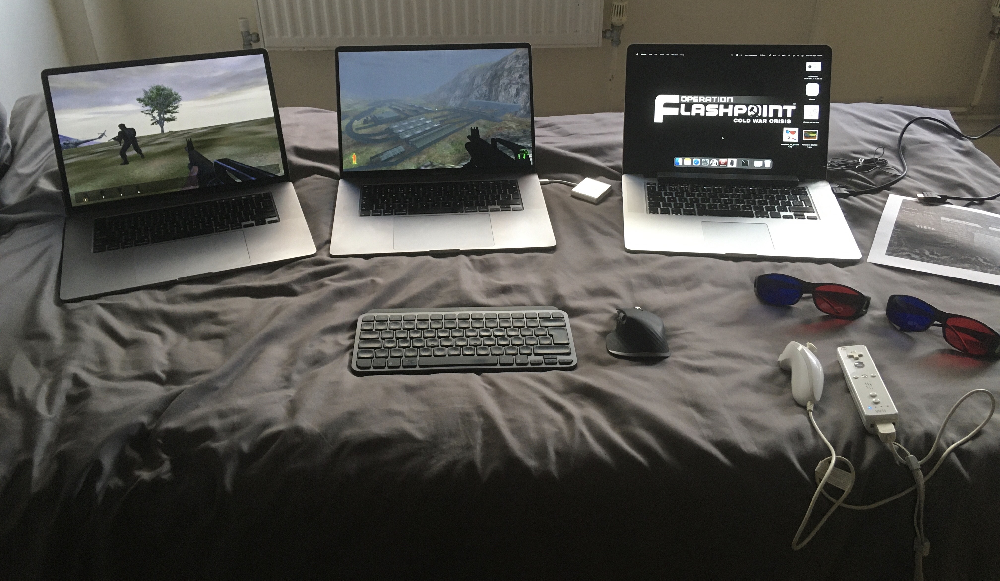
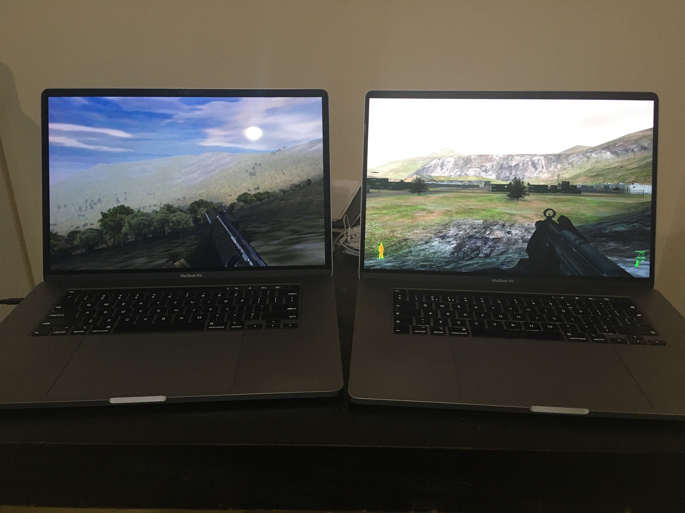
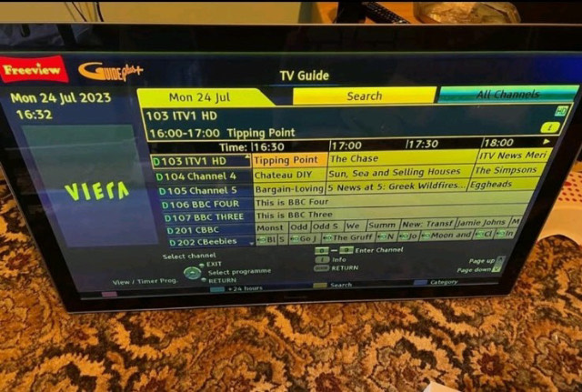
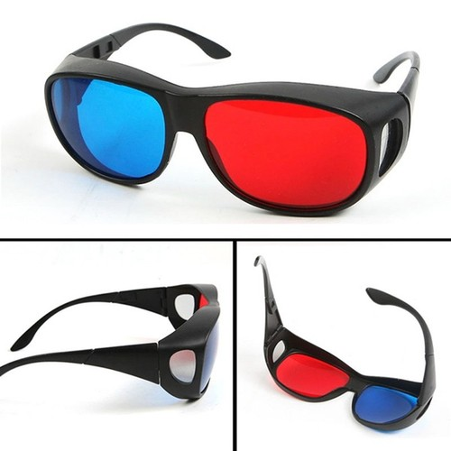
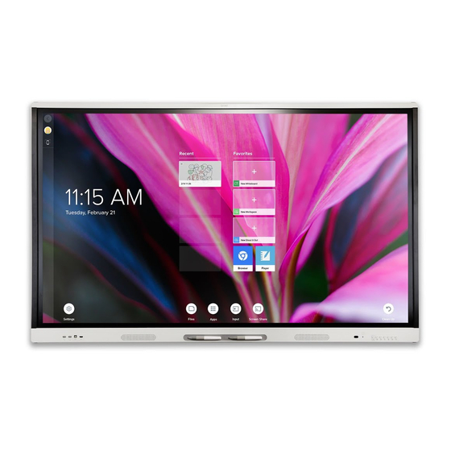
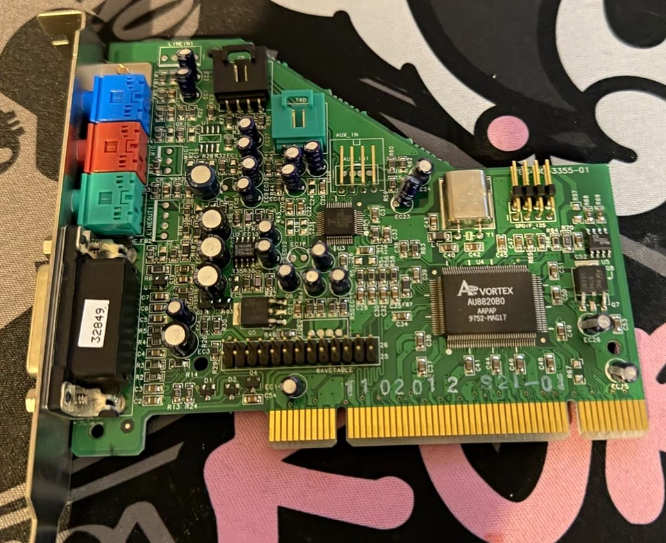
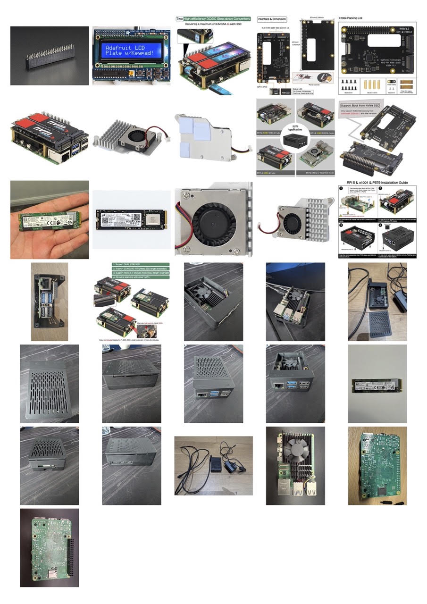

# igi1-macbook-3d-workstation
[Read Macbooks.txt](https://github.com/igiteam/igi1-macbook-3d-workstation/blob/main/Macbooks.txt)

> [README.md](https://readme.macosxjs.com/?url=https%3A%2F%2Fgithub.com%2Figiteam%2Figi1-macbook-3d-workstation%2Fblob%2Fmain%2FREADME.md) [RELEASE.md](https://readme.macosxjs.com/?url=https%3A%2F%2Fgithub.com%2Figiteam%2Figi1-macbook-3d-workstation%2Fblob%2Fmain%2FRELEASE.md)

[https://igiteam.github.io/igi1-macbook-3d-workstation/](https://igiteam.github.io/igi1-macbook-3d-workstation/)









[](https://raw.githubusercontent.com/igiteam/igi1-macbook-3d-workstation/main/smart-board-mx-v4-series-monitor-manual.pdf)


## Operation Flashpoint Cold War Crisis - Project IGI Remake
https://readme.macosxjs.com/?url=https%3A%2F%2Fgithub.com%2Figiteam%2Fopenofpcwc-projectigi%2Fblob%2Fmain%2FREADME.md

## Postal 2 Half Dude - The Thing Remake
https://readme.macosxjs.com/?url=https%3A%2F%2Fgithub.com%2Figiteam%2Fpostal2-half-dude-the-thing%2Fblob%2Fmain%2FREADME.md

## Delta Force Black Hawk Down Team Sabre - Project IGI 2 Remake
https://readme.macosxjs.com/?url=https%3A%2F%2Fgithub.com%2Figiteam%2Fdfbhdts-projectigi-2%2Fblob%2Fmain%2FREADME.md

## Thief Dark Project - Prince of Persia 3D Remake
https://readme.macosxjs.com/?url=https%3A%2F%2Fgithub.com%2Figiteam%2Fthief-dark-project-prince-of-persia-3d%2Fblob%2Fmaster%2FREADME.md

## Half-Life 2 — Wolfschanze 1944 Remake
https://readme.macosxjs.com/?url=https%3A%2F%2Fgithub.com%2Figiteam%2Fhl2-wolfschanze1944%2Fblob%2Fmain%2FREADME.md

## F.E.A.R - Dark Messiah of Might and Magic — Nosferatu Wrath of Malachi Remake
https://readme.macosxjs.com/?url=https%3A%2F%2Fgithub.com%2Figiteam%2Ffear-dmmm-nosferatu-wrath-of-malachi%2Fblob%2Fmain%2FREADME.md

## 007 Goldeneye - Tomorrow Never Dies Remake
https://readme.macosxjs.com/?url=https%3A%2F%2Fgithub.com%2Figiteam%2F007-goldeneye-tomorrow-never-dies%2Fblob%2Fmain%2Freadme.md

## Medal Of Honor Allied Assault - Medal Of Honor PSX Remake
https://readme.macosxjs.com/?url=https%3A%2F%2Fgithub.com%2Figiteam%2Fopenmohaa-medal-of-honor-psx%2Fblob%2Fmain%2FREADME.md

## Jedi Knight Dark Forces 2 - Star Wars Episode I-II-III Remake
https://readme.macosxjs.com/?url=https%3A%2F%2Fgithub.com%2Figiteam%2Fopenjkdf2-star-wars-episode-i-ii-iii%2Fblob%2Fmaster%2FREADME.md

## LEGO Racers - LEGO Island 2 - LEGO Spyrius
https://readme.macosxjs.com/?url=https%3A%2F%2Fgithub.com%2Figiteam%2Flego-racers-island-2-spyrius%2Fblob%2Fmain%2FREADME.md

## Medal Of Honor Pacific Assault - Vietnam
https://readme.macosxjs.com/?url=https%3A%2F%2Fgithub.com%2Figiteam%2Fmohpa-vietnam%2Fblob%2Fmain%2FREADME.md

## Red Faction - Red Faction II Remake
https://readme.macosxjs.com/?url=https%3A%2F%2Fgithub.com%2Figiteam%2Fred-faction-red-faction-2%2Fblob%2Fmaster%2FREADME.md

## Spider-Man The Movie - Spider-Man The Movie Trilogy
https://readme.macosxjs.com/?url=https%3A%2F%2Fgithub.com%2Figiteam%2Fopentobey-spiderman-trilogy%2Fblob%2Fmaster%2FREADME.md

## Enter The Matrix - Blade Trilogy
https://readme.macosxjs.com/?url=https%3A%2F%2Fgithub.com%2Figiteam%2Fenter-the-matrix-blade-trilogy%2Fblob%2Fmain%2FREADME.md

## Halo Campaign Evolved - HALO CE 1-2-3
https://readme.macosxjs.com/?url=https%3A%2F%2Fgithub.com%2Figiteam%2Fhalo-ce-123%2Fblob%2Fmain%2FREADME.md

## Virtual Cop 2 - Tokyo Zombie
https://readme.macosxjs.com/?url=https%3A%2F%2Fgithub.com%2Figiteam%2Fvirtua-cop-2-tokyo-zombie%2Fblob%2Fmain%2FREADME.md

## Call of Duty 3 - Call Of Duty 2003, Call Of Duty UO, Call Of Duty 2, Big Red One, Finest Hour
https://readme.macosxjs.com/?url=https%3A%2F%2Fgithub.com%2Figiteam%2Fcall-of-duty-3-2006%2Fblob%2Fmain%2FREADME.md

## Arx Fatalis - Vampire The Masquarade Redemption Remake
https://readme.macosxjs.com/?url=https%3A%2F%2Fgithub.com%2Figiteam%2Farx-fatalis-vampire-the-masquerade-redemption%2Fblob%2Fmaster%2FREADME.md

## Indiana Jones and the Emperor's Tomb - Indiana Jones and the Infernal Machine Remake
https://readme.macosxjs.com/?url=https%3A%2F%2Fgithub.com%2Figiteam%2Findiana-jones-emperors-tomb-indiana-jones-infernal-machine%2Fblob%2Fmain%2FREADME.md

## Return To Castle Wolfeinstein - Mortyr 1944 Remake
https://readme.macosxjs.com/?url=https%3A%2F%2Fgithub.com%2Figiteam%2Fiortcw-mortyr-1944%2Fblob%2Fmaster%2FREADME.md

## Operation Flashpoint Cold War Crisis — Hidden & Dangerous Remake
https://readme.macosxjs.com/?url=https%3A%2F%2Fgithub.com%2Figiteam%2Fopenofpcwc-hidden-and-dangerous%2Fblob%2Fmain%2FREADME.md

## Die Hard Nakatomi Plaza - Die Hard Trilogy Remake
https://readme.macosxjs.com/?url=https%3A%2F%2Fgithub.com%2Figiteam%2Fdie-hard-nakatomi-plaza-die-hard-trilogy%2Fblob%2Fmain%2FREADME.md

## ONI - The Fifth Element Remake
https://readme.macosxjs.com/?url=https%3A%2F%2Fgithub.com%2Figiteam%2Foni-the-fifth-element%2Fblob%2Fmain%2FREADME.md

## Halo Combat Evolved - Duke Nukem 3D Remake
https://readme.macosxjs.com/?url=https%3A%2F%2Fgithub.com%2Figiteam%2Fhalo-ce-duke-nukem-3d%2Fblob%2Fmain%2FREADME.md

## Terminator War of The Machines - Terminator Future Shock Remake
https://readme.macosxjs.com/?url=https%3A%2F%2Fgithub.com%2Figiteam%2Fterminator-war-of-the-machines-terminator-future-shock%2Fblob%2Fmain%2FREADME.md

## Serious Sam The First Encounter - Starship Troopers 2005 Remake
https://readme.macosxjs.com/?url=https%3A%2F%2Fgithub.com%2Figiteam%2Fserious-sam-first-encounter-starship-troopers-2005%2Fblob%2Fmain%2FREADME.md

## Duke Nukem Forever 2001
https://readme.macosxjs.com/?url=https%3A%2F%2Fgithub.com%2Figiteam%2Fduke-nukem-forever-2001%2Fblob%2Fmain%2FREADME.md

## Midtown Madness 3 - Redriver Driv3r Remake
https://readme.macosxjs.com/?url=https%3A%2F%2Fgithub.com%2Figiteam%2Fmidtown-madness-3-redriver-driv3r%2Fblob%2Fmain%2FREADME.md

## S.T.A.L.K.E.R - Oblivion Lost 
https://readme.macosxjs.com/?url=https%3A%2F%2Fgithub.com%2Figiteam%2Fstalker-oblivion-lost%2Fblob%2Fdev%2FREADME.md

## Hitman Codename 47 - Mission Impossible PSX Remake
https://readme.macosxjs.com/?url=https%3A%2F%2Fgithub.com%2Figiteam%2Fhitman-codename-47-mission-impossible-psx%2Fblob%2Fmain%2FREADME.md

## Max Payne 2001
https://readme.macosxjs.com/?url=https%3A%2F%2Fgithub.com%2Figiteam%2Fmax-payne-2001%2Fblob%2Fmain%2FREADME.md

## Bloodrayne - Underworld Trilogy 
https://readme.macosxjs.com/?url=https%3A%2F%2Fgithub.com%2Figiteam%2Fbloodrayne-underworld-trilogy%2Fblob%2Fmain%2FREADME.md

## Far Cry 2004
https://readme.macosxjs.com/?url=https%3A%2F%2Fgithub.com%2Figiteam%2Ffar-cry-2004%2Fblob%2Fmain%2FREADME.md

## Call of Duty 2 - Hour of Victory Remake
https://readme.macosxjs.com/?url=https%3A%2F%2Fgithub.com%2Figiteam%2Fcod2-hour-of-victory%2Fblob%2Fmain%2FREADME.md

## Alien Vs Predator Classic - Alien Resurrection Remake
https://readme.macosxjs.com/?url=https%3A%2F%2Fgithub.com%2Figiteam%2Falien-vs-predator-classic-alien-resurrection%2Fblob%2Fmain%2FREADME.md

## Tactical Intervention - Rainbow Six 1998 Remake
https://readme.macosxjs.com/?url=https%3A%2F%2Fgithub.com%2Figiteam%2Ftactical-intervention-rainbow-six-1998%2Fblob%2Fmain%2FREADME.md

## Doom3 E3 Alpha - Return To Castle Wolfeinstein Remake
https://readme.macosxjs.com/?url=https%3A%2F%2Fgithub.com%2Figiteam%2Fdoom3-e3-alpha-rtcw%2Fblob%2Fmaster%2FREADME.md

## Transformers Takara - Transformers The Movie 1986
https://readme.macosxjs.com/?url=https%3A%2F%2Fgithub.com%2Figiteam%2Ftransformers-takara-transformers-the-movie-1986%2Fblob%2Fmain%2FREADME.md

## Far Cry 2004 - Aliens vs Predator 2 Remake
https://readme.macosxjs.com/?url=https%3A%2F%2Fgithub.com%2Figiteam%2Ffar-cry-2004-aliens-vs-predator-2%2Fblob%2Fmain%2FREADME.md

## Call of Duty 2003 - Brothers in Arms Wii Remake
https://readme.macosxjs.com/?url=https%3A%2F%2Fgithub.com%2Figiteam%2Fcod2003-brothers-in-arms-wii%2Fblob%2Fmain%2FREADME.md

## Marines Modern Urban Combat Wii - Swat3 Remake
https://readme.macosxjs.com/?url=https%3A%2F%2Fgithub.com%2Figiteam%2Fmarines-modern-urban-combat-wii-swat3%2Fblob%2Fmain%2FREADME.md

## Mafia 2001
https://readme.macosxjs.com/?url=https%3A%2F%2Fgithub.com%2Figiteam%2Fmafia-2001%2Fblob%2Fmaster%2FREADME.md

## Bloodrayne 2 - Spawn The Eternal PSX Remake
https://readme.macosxjs.com/?url=https%3A%2F%2Fgithub.com%2Figiteam%2Fbloodrayne2-spawn-the-eternal-psx%2Fblob%2Fmain%2FREADME.md

## Half-Life Decay 2001
https://readme.macosxjs.com/?url=https%3A%2F%2Fgithub.com%2Figiteam%2Fhalf-life-decay-2001%2Fblob%2Fmain%2FREADME.md

## Medal of Honor Vanguard Wii - WW2 Combat Road To Berlin Remake
https://readme.macosxjs.com/?url=https%3A%2F%2Fgithub.com%2Figiteam%2Fmedal-of-honor-vanguard-wii-ww2-combat-road-to-berlin%2Fblob%2Fmain%2FREADME.md

## Grand Theft Auto IV - The Getaway PSX Remake
https://readme.macosxjs.com/?url=https%3A%2F%2Fgithub.com%2Figiteam%2Fgtaiv-the-getaway-psx%2Fblob%2Fmain%2FREADME.md

## Colin McRae Rally 2 - Mobile Rally Championship PSX Remake
https://readme.macosxjs.com/?url=https%3A%2F%2Fgithub.com%2Figiteam%2Fcolin-mcrae-rally-2-mobile-rally-championship-psx%2Fblob%2Fmain%2FREADME.md

## Tomb Raider 1996 - The Mummy PSX Remake
https://readme.macosxjs.com/?url=https%3A%2F%2Fgithub.com%2Figiteam%2Ftomb-raider-1996-the-mummy-psx%2Fblob%2Fmaster%2FREADME.md

## Soldier of Fortune 2000 - Syphon Filter PSX Remake
https://readme.macosxjs.com/?url=https%3A%2F%2Fgithub.com%2Figiteam%2Fsoldier-of-fortune-2000-syphon-filter-psx%2Fblob%2Fmaster%2FREADME.md

## Ghost Recon Advanced Warfighter 2006 - Deadly Dozen 2001
https://readme.macosxjs.com/?url=https%3A%2F%2Fgithub.com%2Figiteam%2Fghost-recon-advanced-warfighter-2006-deadly-dozen-2001%2Fblob%2Fmain%2FREADME.md

## GTAIII - They live
https://readme.macosxjs.com/?url=https%3A%2F%2Fgithub.com%2Figiteam%2Fgta-iii-they-live%2Fblob%2Fmain%2FREADME.md

## Call Of Juarez Bound in Blood - Gun Warrior Remake
https://readme.macosxjs.com/?url=https%3A%2F%2Fgithub.com%2Figiteam%2Fcall-of-juarez-bound-in-blood-gun-warrior%2Fblob%2Fmain%2FREADME.md

## F.E.A.R - History Channel Battle For Pacific Remake
https://readme.macosxjs.com/?url=https%3A%2F%2Fgithub.com%2Figiteam%2Ffear-history-channel-battle-for-pacific%2Fblob%2Fmain%2FREADME.md


---

## Video Game Engines

[https://chromeenginegames.macosxjs.com/](https://chromeenginegames.macosxjs.com/)

[https://gamebryoenginegames.macosxjs.com/](https://gamebryoenginegames.macosxjs.com/)

[https://idtechenginegames.macosxjs.com/](https://idtechenginegames.macosxjs.com/)

[https://lithtechenginegames.macosxjs.com/](https://lithtechenginegames.macosxjs.com/)

[https://unrealenginegames.macosxjs.com/](https://unrealenginegames.macosxjs.com/)

[https://renderwareenginegames.macosxjs.com/](https://renderwareenginegames.macosxjs.com/)

## Video Game Magazines

[https://igiteam.github.io/pczonemagazines/](https://igiteam.github.io/pczonemagazines/)

[https://igiteam.github.io/xboxmagazines/](https://igiteam.github.io/xboxmagazines/)

## Video Game Covers

[https://xboxgames.macosxjs.com](https://xboxgames.macosxjs.com)

[https://wiigames.macosxjs.com](https://wiigames.macosxjs.com)

[https://ps3games.macosxjs.com](https://ps3games.macosxjs.com)

[https://xbox360games.macosxjs.com](https://xbox360games.macosxjs.com)

[https://pspgames.macosxjs.com](https://pspgames.macosxjs.com)

[https://ps1games.macosxjs.com](https://ps1games.macosxjs.com)

[https://pcgames.macosxjs.com](https://pcgames.macosxjs.com)

[https://n64games.macosxjs.com](https://n64games.macosxjs.com)

[https://dreamcastgames.macosxjs.com](https://dreamcastgames.macosxjs.com)

[https://gbagames.macosxjs.com](https://gbagames.macosxjs.com)

[https://gamecubegames.macosxjs.com](https://gamecubegames.macosxjs.com)

---

[https://ps2games.macosxjs.com](https://ps2games.macosxjs.com)

[https://3dogames.macosxjs.com](https://3dogames.macosxjs.com)

[https://segasaturngames.macosxjs.com](https://segasaturngames.macosxjs.com)

[https://snesgames.macosxjs.com](https://snesgames.macosxjs.com)

[https://segagenesisgames.macosxjs.com](https://segagenesisgames.macosxjs.com)

## Video Games
  
[https://videogameslibrary.macosxjs.com](https://videogameslibrary.macosxjs.com)

[https://ue3.macosxjs.com/](https://ue3.macosxjs.com/)

---


## WebAssembly Games 
[https://readme.macosxjs.com/?url=https%3A%2F%2Fgithub.com%2Figiteam%2Fwebassembly_games%2Fblob%2Fmain%2FREADME.md](https://readme.macosxjs.com/?url=https%3A%2F%2Fgithub.com%2Figiteam%2Fwebassembly_games%2Fblob%2Fmain%2FREADME.md)

## Web Windows
[https://readme.macosxjs.com/?url=https%3A%2F%2Fgithub.com%2Figiteam%2Fweb-windows-games%2Fblob%2Fmain%2FREADME.md](https://readme.macosxjs.com/?url=https%3A%2F%2Fgithub.com%2Figiteam%2Fweb-windows-games%2Fblob%2Fmain%2FREADME.md)

## Nvidia DirectX Shaders Collection
[https://nvidiashaders.macosxjs.com/](https://nvidiashaders.macosxjs.com/)

## FilmStrip Creator
[https://filmstrip.macosxjs.com](https://filmstrip.macosxjs.com)

## wine-games-tracker.html
[https://html.macosxjs.com/?https://raw.githubusercontent.com/igiteam/igi1-macbook-3d-workstation/refs/heads/main/wine-games-tracker.html](https://html.macosxjs.com/?https://raw.githubusercontent.com/igiteam/igi1-macbook-3d-workstation/refs/heads/main/wine-games-tracker.html)

## Games Decompilations List
https://readme.macosxjs.com/?url=https%3A%2F%2Fgithub.com%2FCarter54git%2FGreates-Games-Decompilations-List%2Fblob%2Fmain%2FREADME.md

## WS11WineCX20.0.4 (MacOSX Big Sur 32bit)
[WS11WineCX20.0.4.tar.7z](https://github.com/vitor251093/porting-kit-engines/releases/download/wineskin/WS11WineCX20.0.4.tar.7z)

[](https://github.com/igiteam/wine_engines)

---

### Block 1
- `openofpcwc-projectigi`
- `postal2-half-dude-the-thing`
- `thief-dark-project-prince-of-persia-3d`
- `dfbhdts-projectigi-2`

### Block 2
- `hl2-wolfschanze1944`
- `fear-dmmm-nosferatu-wrath-of-malachi`
- `openmohaa-medalofhonor-psx`
- `openjkdf2-star-wars-episode-i-ii-iii`

### Block 3
- `lego-racer-island-2-spyrius`
- `mohpa-vietnam`
- `red-faction-red-faction-2`
- `opentobey-spiderman-trilogy`

### Block 4
- `enter-the-matrix-blade-trilogy`
- `serious-sam-first-encounter-starship-troopers-2005-2005`
- `terminator-war-of-the-machines-terminator-future-shock`
- `die-hard-nakatomi-plaza-die-hard-trilogy`

### Block 5
- `007-goldeneye-tomorrow-never-dies`
- `tomb-raider-1996-the-mummy-psx`
- `alien-vs-predator-classic-alien-resurrection`
- `arx-fatalis-vampire-the-masquerade-redemption`

### Block 6
- `bloodrayne-underworld-trilogy`
- `transformers-takara-transformers-the-movie-1986`
- `oni-fifth-element`
- `bloodrayne2-spawn-the-eternal-psx`

## Block 7
- `openofpcwc-hidden-and-dangerous`
- `cod2-hour-of-victory`
- `cod2003-brothers-in-arms-wii`
- `halo-ce-1-2-3`

## Block 8
- `hitman-codename-47-mission-impossible-psx`
- `colin-mcrae-rally-2-mobile-rally-championship-psx`
- `call-of-juarez-bound-in-blood-gun-warrior`
- `r6-vegas-kill-switch-2004`

## Block 9
- `r6-vegas-ghost-recon-2001`
- `virtua-cop-2-tokyo-zombie`
- `gta-iii-they-live`
- `indiana-jones-emperors-tomb-indiana-jones-infernal-machine`

## Block 10
- `iortcw-mortyr-1944`
- `call-of-duty-3-2006`
- `fear-history-channel-battle-for-pacific`
- `halo-ce-duke-nukem-3d`

## Block 11
- `stalker-oblivion-lost`
- `duke-nukem-forever-2001`
- `midtown-madness-3-redriver-driv3r`
- `max-payne-2001`

## Block 12
- `far-cry-2004`
- `ghost-recon-advanced-warfighter-2006-deadly-dozen-2001`
- `ww2-combat-road-to-berlin`
- `marines-modern-urban-combat-wii-swat3`

## Block 13
- `medal-of-honor-vanguard-wii-ww2-combat-road-to-berlin`
- `tactical-intervention-rainbow-six-1998`
- `doom3-e3-alpha-rtcw`
- `far-cry-2004-aliens-vs-predator-2`
  
## Block 14
- `mafia-2001`
- `half-life-decay-2001`
- `gtaiv-the-getaway-psx`
- `soldier-of-fortune-2000-syphon-filter-psx`

  

### Reference Images: Sony MDR-V6

These are period-correct studio monitors, highly recommended for testing the "analytical" side of Aureal Vortex A3D.

| Image 1 | Image 2 | Image 3 | Image 4 |
| :---: | :---: | :---: | :---: |
|  |  |  |  |

*(Note: These images are from an eBay listing, used here for product identification.)*



---
  
```
┌─────────────────────────────────────────────────────────────────────────┐
│                    WHY THIS SETUP EXISTS                                │
│                    3D DEVELOPMENT STUDIO                                │
└─────────────────────────────────────────────────────────────────────────┘
```


Remake classic PC games — faithfully and fast — across multiple engines.

Not ports. Not remasters with new assets. Recreations that run the original gameplay,
original maps, original feel — rebuilt on modern engines so they can be extended,
modded, and preserved.

Target list (so far):

    Project IGI → Operation Flashpoint

    The Thing → Postal 2

    Wolfschanze 1944 → Half-Life 2

    Nosferatu: Wrath of Malachi → F.E.A.R. / Dark Messiah

    ...and more

Why Three Macs

Because game remaking is not one job. It's three jobs happening at once:
text

  MAC 1 (Canvas)      →  You BUILD the game
  MAC 2 (Reference)   →  You LOOK at the original
  MAC 3 (Testing)     →  You PLAY the result

If you try to do all three on one machine, you spend half your day:

    Alt-tabbing between windows

    Losing your editor state

    Reloading the reference every time you test

    Fighting Wine + editor + game + tools on one CPU

Three Macs = three jobs = zero context switching.
Why Three macOS Versions

Each macOS version has a reason:
  Monterey 12.4   →  Best balance for OFP Mission Editor + dev tools, compilation
  Sonoma 14.5     →  Modern tooling, VSCode, Xcode, Swift, browsers, ORIGINAL GAME, compilation
  Big Sur 11.7    →  Runs the test game + Wine configs + wiimote (bluetooth 2.1 compatibility)

Some legacy games only run on older macOS. Some dev tools only run on newer.
By having all three, you never hit "this doesn't work on my OS."
Why the VT30 3D Plasma

Operation Flashpoint and other games in the list were meant to be immersive.
A 55" 3D plasma output means:
    Full-screen 3D preview of what you're building
    Anaglyph testing on real hardware, not a small laptop screen
    Shared display for all three Macs (HDMI 1, 2, 3) — no KVM needed
    The room IS the dev environment — walk from desk to TV, keep working

Why the Wii Remotes + IR Sensor Bars

Traditional dev = mouse + keyboard. But you're recreating games that had:
    Motion controls
    Point-and-shoot aiming
    Gesture-based interaction

You can't test those with a mouse. The Wiimote + nunchuck lets you:
    Play-test the exact input the game was designed for
    Record motion for animation reference
    Feel the game the way players will

Two IR bars = seamless desk ↔ TV workflow:
    At the desk → point Wiimote at Mac's IR bar → keep developing
    Walk to the TV → point Wiimote at TV's IR bar → play-test full screen
    Same Wiimote, same game, same state. Just move your feet.

Why Logitech Flow

One mouse. One keyboard. Three Macs.

The custom app (igiteam/logitec_mx_mouse_3_macos) bridges the gap that Logitech
Options+ refused to bridge across Big Sur / Monterey / Sonoma.

Result: one input device for the whole studio. No KVM, no extra peripherals,
no copy-paste between machines by hand.
Why eBay Tracking Matters

This entire setup was sourced from eBay over ~3 weeks.
Total cost: £1,302.35 for a studio that would cost 4–5x that new.

Tracking it means:
    When a part fails, you know the exact model + fair price
    When you onboard someone, you can quote a real number
    When prices drop, you know it's time to buy spares
    The setup becomes replicable, not just documented

The Deeper Why

Every game remake that ships from this studio proves the model works:
    Speed: multiple titles per year, not per decade
    Fidelity: original feel, not "reimagined"
    Scalability: hand a new team member this doc → they're productive in days
    Preservation: games from 2000–2010 that would otherwise be lost

The point isn't the hardware. The point is that this hardware removes every excuse
not to ship. No "I can't test 3D". No "I can't run the original". No "my Mac can't
handle both the editor and the game at once."

Every friction point has a dedicated machine, a dedicated OS, a dedicated screen.

---

# Support Buy Me Coffee
[https://buymeacoffee.com/igiteam](https://buymeacoffee.com/igiteam)


# PORTABLE FORGEJOGITLF Ubuntu Git Server
https://github.com/igiteam/igi1-macbook-3d-workstation/blob/main/raspberry-pi5-ssd/README.md
## Raspberry-pi-5-portable-1tb-forgejogitlf-ubuntu.pdf
https://raw.githubusercontent.com/igiteam/igi1-macbook-3d-workstation/refs/heads/main/raspberry-pi5-ssd/raspberry-pi-5-portable-forgejogitlf-ubuntu.pdf

[](https://htmlpreview.github.io/?https://raw.githubusercontent.com/igiteam/igi1-macbook-3d-workstation/refs/heads/main/rapsberry-pi5-forgejogitlfs/Raspberry%20Pi%20Build%20Cost%20Comparison.html)

