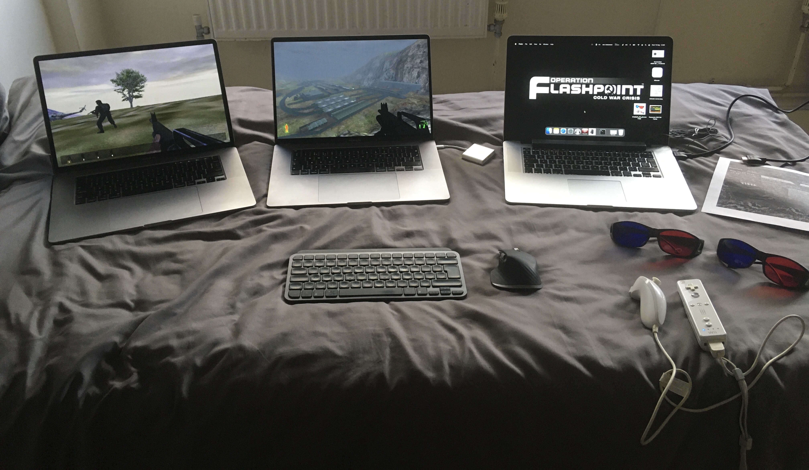
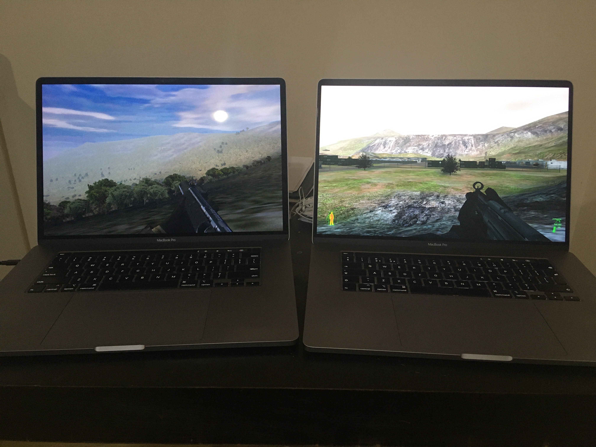
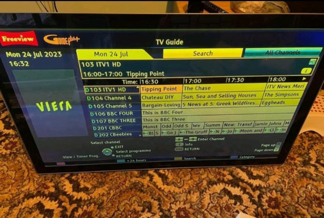
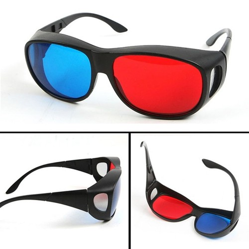
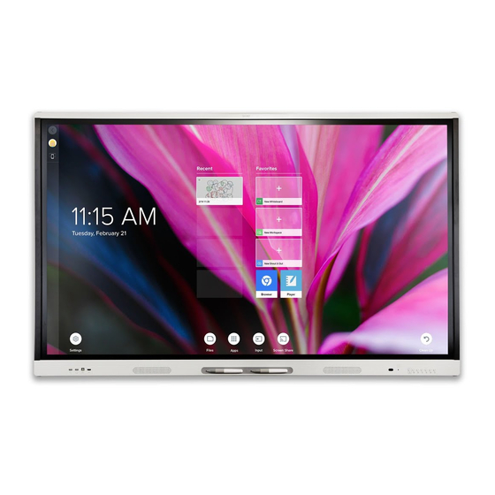
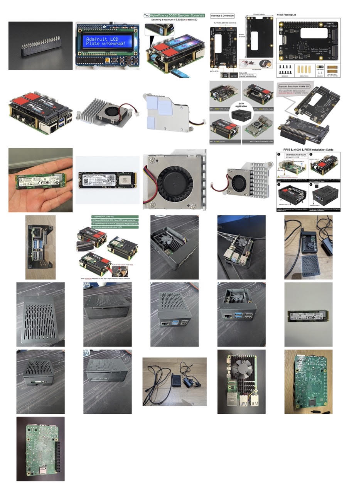

# igi1-macbook-3d-workstation
> Read Macbooks.txt 
[Read Macbooks.txt](https://github.com/igiteam/igi1-macbook-3d-workstation/blob/main/Macbooks.txt)

[https://readme.macosxjs.com/?url=https%3A%2F%2Fgithub.com%2Figiteam%2Figi1-macbook-3d-workstation%2Fblob%2Fmain%2FREADME.md](https://readme.macosxjs.com/?url=https%3A%2F%2Fgithub.com%2Figiteam%2Figi1-macbook-3d-workstation%2Fblob%2Fmain%2FREADME.md)









[](https://raw.githubusercontent.com/igiteam/igi1-macbook-3d-workstation/main/smart-board-mx-v4-series-monitor-manual.pdf)


## Operation Flashpoint Cold War Crisis - Project IGI Remake
https://readme.macosxjs.com/?url=https%3A%2F%2Fgithub.com%2Figiteam%2Fopenofpcwc%2Fblob%2Fmain%2FREADME.md

## Postal 2 Half Dude - The Thing Remake
https://readme.macosxjs.com/?url=https%3A%2F%2Fgithub.com%2Figiteam%2Fpostal2-half-dude-the-thing%2Fblob%2Fmain%2FREADME.md

## Half-Life 2 — Wolfschanze 1944 Remake
https://readme.macosxjs.com/?url=https%3A%2F%2Fgithub.com%2Figiteam%2Fhl2-wolfschanze1944%2Fblob%2Fmain%2FREADME.md

## F.E.A.R - Dark Messiah of Might and Magic — Nosferatu Wrath of Malachi Remake
https://readme.macosxjs.com/?url=https%3A%2F%2Fgithub.com%2Figiteam%2Ffear-dmmm-nosferatu-wrath-of-malachi%2Fblob%2Fmain%2FREADME.md

## Thief Gold: Prince of Persia 3D Remake
https://readme.macosxjs.com/?url=https%3A%2F%2Fgithub.com%2Figiteam%2Fthief-gold-prince-of-persia-3d%2Fblob%2Fmaster%2FREADME.md

## 007 Goldeneye - Tomorrow Never Dies Remake
https://readme.macosxjs.com/?url=https%3A%2F%2Fgithub.com%2Figiteam%2F007-goldeneye-tomorrow-never-dies%2Fblob%2Fmain%2Freadme.md

## Medal Of Honor Allied Assault - Medal Of Honor PSX Remake
https://readme.macosxjs.com/?url=https%3A%2F%2Fgithub.com%2Figiteam%2Fopenmohaa-medal-of-honor-psx%2Fblob%2Fmain%2FREADME.md

## Jedi Knight Dark Forces 2 - Star Wars Episode I-II-III Remake
https://readme.macosxjs.com/?url=https%3A%2F%2Fgithub.com%2Figiteam%2Fopenjkdf2-star-wars-episode-i-ii-iii%2Fblob%2Fmaster%2FREADME.md

## LEGO Racers - LEGO Island 2 - LEGO Spyrius
https://readme.macosxjs.com/?url=https%3A%2F%2Fgithub.com%2Figiteam%2Flego-racers-island-2-spyrius%2Fblob%2Fmain%2FREADME.md

## WebAssembly Games 
[https://github.com/igiteam/webassembly_games](https://github.com/igiteam/webassembly_games)


## wine-games-tracker.html
[https://raw.githubusercontent.com/igiteam/igi1-macbook-3d-workstation/refs/heads/main/wine-games-tracker.html](https://htmlpreview.github.io/?https://raw.githubusercontent.com/igiteam/igi1-macbook-3d-workstation/refs/heads/main/wine-games-tracker.html)

## WS11WineCX20.0.4 (MacOSX Big Sur 32bit)
[WS11WineCX20.0.4.tar.7z](https://github.com/vitor251093/porting-kit-engines/releases/download/wineskin/WS11WineCX20.0.4.tar.7z)

[](https://github.com/igiteam/wine_engines)
---

### Block 1
- `openofpcwc-projectigi`
- `postal2-half-dude-the-thing`
- `hl2-wolfschanze1944`
- `fear-dmmm-nosferatu-wrath-of-malachi`

### Block 2
- `thief-gold-prince-of-persia-3d`
- `007-goldeneye-tomorrow-never-dies`
- `openmohaa-medalofhonor-psx`
- `openjkdf2-star-wars-episode-i-ii-iii`

### Block 3
- `lego-racer-island-2-spyrius`
- `mohpa-vietnam`
- `arx-fatalis-vampire-the-masquerade-redemption`
- `opentobey-spiderman-trilogy`

### Block 4
- `enter-the-matrix-blade-trilogy`
- `serious-sam-first-encounter-starship-troopers`
- `terminator-war-of-the-machines-future-shock`
- `die-hard-nakatomi-plaza-die-hard-trilogy`

### Block 5
- `openlara-the-mummy`
- `bloodrayne-spawn-the-eternal`
- `alien-vs-predator-classic-alien-resurrection`
- `red-faction-red-faction-2`

### Block 6
- `bloodrayne-underworld-trilogy`
- `transformers-takara-the-movie`
- `openmohaa-project-igi-2`
- `oni-fifth-element`

## Block 7
- `openofpcwc-hidden-and-dangerous`
- `cod2-hour-of-victory`
- `cod1-brothers-in-arms`
- `fear-history-channel-battle-for-pacific`

## Block 8
- `hitman-codename-47-mission-impossible-psx`
- `colin-mcrae-rally-2-mobile-rally-championship-psx`
- `call-of-juarez-bound-in-blood-gun-warrior`
- `r6-vegas-kill-switch`

## Block 9
- `r6-vegas-ghost-recon-2001`
- `virtual-cop-2-tokyo-zombie-arcade`
- `gta-iii-they-live`
- `indiana-jones-emperors-tomb-infernal-machine`

## Block 10
- `iortcw-mortyr-1944`

  
# PORTABLE FORGEJOGITLF Ubuntu Git Server
https://github.com/igiteam/igi1-macbook-3d-workstation/blob/main/raspberry-pi5-ssd/README.md
## Raspberry-pi-5-portable-1tb-forgejogitlf-ubuntu.pdf
https://raw.githubusercontent.com/igiteam/igi1-macbook-3d-workstation/refs/heads/main/raspberry-pi5-ssd/raspberry-pi-5-portable-forgejogitlf-ubuntu.pdf

[](https://htmlpreview.github.io/?https://raw.githubusercontent.com/igiteam/igi1-macbook-3d-workstation/refs/heads/main/rapsberry-pi5-forgejogitlfs/Raspberry%20Pi%20Build%20Cost%20Comparison.html)

```
┌─────────────────────────────────────────────────────────────────────────┐
│                    WHY THIS SETUP EXISTS                                │
│                    3D DEVELOPMENT STUDIO                                │
└─────────────────────────────────────────────────────────────────────────┘
```


Remake classic PC games — faithfully and fast — across multiple engines.

Not ports. Not remasters with new assets. Recreations that run the original gameplay,
original maps, original feel — rebuilt on modern engines so they can be extended,
modded, and preserved.

Target list (so far):

    Project IGI → Operation Flashpoint

    The Thing → Postal 2

    Wolfschanze 1944 → Half-Life 2

    Nosferatu: Wrath of Malachi → F.E.A.R. / Dark Messiah

    ...and more

Why Three Macs

Because game remaking is not one job. It's three jobs happening at once:
text

  MAC 1 (Canvas)      →  You BUILD the game
  MAC 2 (Reference)   →  You LOOK at the original
  MAC 3 (Testing)     →  You PLAY the result

If you try to do all three on one machine, you spend half your day:

    Alt-tabbing between windows

    Losing your editor state

    Reloading the reference every time you test

    Fighting Wine + editor + game + tools on one CPU

Three Macs = three jobs = zero context switching.
Why Three macOS Versions

Each macOS version has a reason:
  Monterey 12.4   →  Best balance for OFP Mission Editor + dev tools, compilation
  Sonoma 14.5     →  Modern tooling, VSCode, Xcode, Swift, browsers, ORIGINAL GAME, compilation
  Big Sur 11.7    →  Runs the test game + Wine configs + wiimote (bluetooth 2.1 compatibility)

Some legacy games only run on older macOS. Some dev tools only run on newer.
By having all three, you never hit "this doesn't work on my OS."
Why the VT30 3D Plasma

Operation Flashpoint and other games in the list were meant to be immersive.
A 55" 3D plasma output means:
    Full-screen 3D preview of what you're building
    Anaglyph testing on real hardware, not a small laptop screen
    Shared display for all three Macs (HDMI 1, 2, 3) — no KVM needed
    The room IS the dev environment — walk from desk to TV, keep working

Why the Wii Remotes + IR Sensor Bars

Traditional dev = mouse + keyboard. But you're recreating games that had:
    Motion controls
    Point-and-shoot aiming
    Gesture-based interaction

You can't test those with a mouse. The Wiimote + nunchuck lets you:
    Play-test the exact input the game was designed for
    Record motion for animation reference
    Feel the game the way players will

Two IR bars = seamless desk ↔ TV workflow:
    At the desk → point Wiimote at Mac's IR bar → keep developing
    Walk to the TV → point Wiimote at TV's IR bar → play-test full screen
    Same Wiimote, same game, same state. Just move your feet.

Why Logitech Flow

One mouse. One keyboard. Three Macs.

The custom app (igiteam/logitec_mx_mouse_3_macos) bridges the gap that Logitech
Options+ refused to bridge across Big Sur / Monterey / Sonoma.

Result: one input device for the whole studio. No KVM, no extra peripherals,
no copy-paste between machines by hand.
Why eBay Tracking Matters

This entire setup was sourced from eBay over ~3 weeks.
Total cost: £1,302.35 for a studio that would cost 4–5x that new.

Tracking it means:
    When a part fails, you know the exact model + fair price
    When you onboard someone, you can quote a real number
    When prices drop, you know it's time to buy spares
    The setup becomes replicable, not just documented

The Deeper Why

Every game remake that ships from this studio proves the model works:
    Speed: multiple titles per year, not per decade
    Fidelity: original feel, not "reimagined"
    Scalability: hand a new team member this doc → they're productive in days
    Preservation: games from 2000–2010 that would otherwise be lost

The point isn't the hardware. The point is that this hardware removes every excuse
not to ship. No "I can't test 3D". No "I can't run the original". No "my Mac can't
handle both the editor and the game at once."

Every friction point has a dedicated machine, a dedicated OS, a dedicated screen.

```
## 1. Install requests
pip3 install requests

## 2. Get your eBay API keys
→ https://developer.ebay.com/my/keys
→ Create an app, grab App ID (Client ID) + Cert ID (Client Secret)

## 2.1 create .env file
EBAY_CLIENT_ID=""
EBAY_CLIENT_SECRET=""

## 3. Export them
export EBAY_CLIENT_ID="YourApp-YourApp-PRD-xxxxxxxxx-xxxxxxxx"
export EBAY_CLIENT_SECRET="PRD-xxxxxxxxxxxx-xxxx-xxxx-xxxx-xxxx"

## 4. Run it (make sure ebay-items.json is in the same folder)
python3 ebay_search.py
```

📦 Loaded 14 items from ebay-items.json

🔑 Getting eBay access token...
✅ Token acquired
```
======================================================================
[1/14] MacBook Pro 16" 2019 i9 8-Core 2.4Ghz 32GB Ram 1TB SSD AMD 5500M 8GB Space Grey
======================================================================
   GBP 474.99   https://www.ebay.co.uk/itm/1234567890
   GBP 499.00   https://www.ebay.co.uk/itm/2345678901
   GBP 525.00   https://www.ebay.co.uk/itm/3456789012
   GBP 549.99   https://www.ebay.co.uk/itm/4567890123
   GBP 579.00   https://www.ebay.co.uk/itm/5678901234

======================================================================
[2/14] MacBook Pro 16" 2019 i9-9880H 2.3 Ghz 1TB SSD 32GB RAM A2141 AMD 5500M 4GB Space Grey
======================================================================
   GBP 349.99   https://www.ebay.co.uk/itm/6789012345
   ...
```

🔑 What You Need to Know
Thing	                Where
eBay Developer Account	developer.ebay.com
App ID (Client ID)	    "Application Keys" → "App ID"
Cert ID (Client Secret)	"Application Keys" → "Cert ID"

Marketplace	EBAY-GB for UK, EBAY-US for US
Rate limit	5 calls/sec default — the script sleeps 0.5s between items
