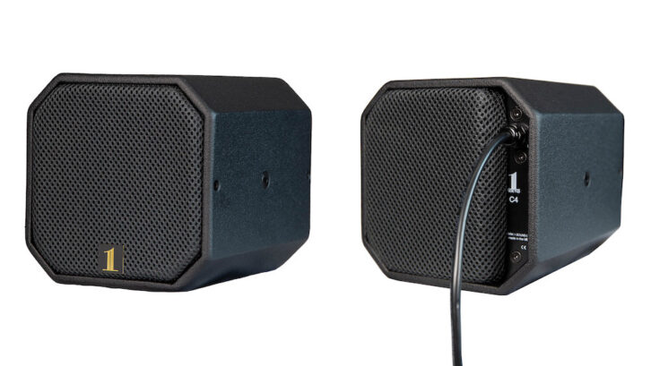
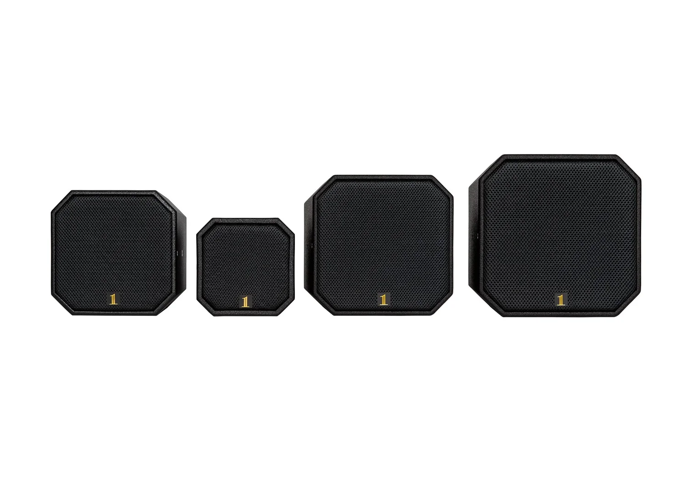
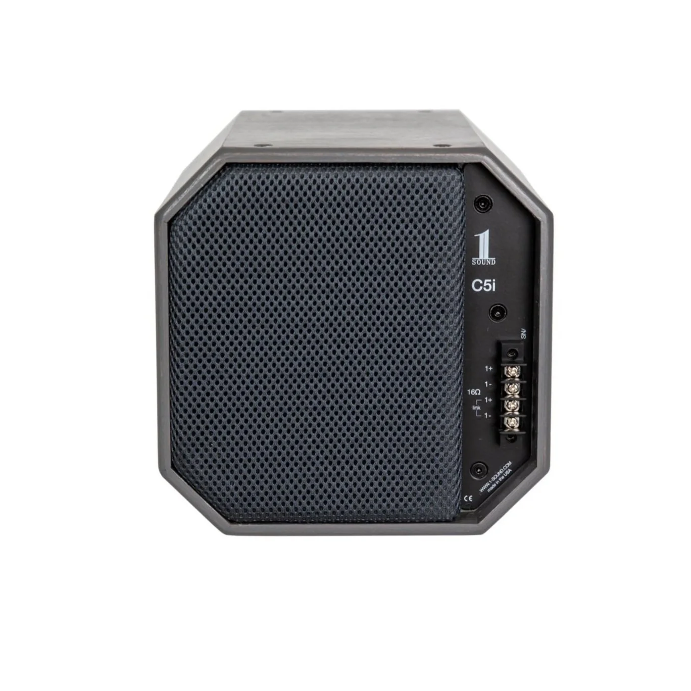
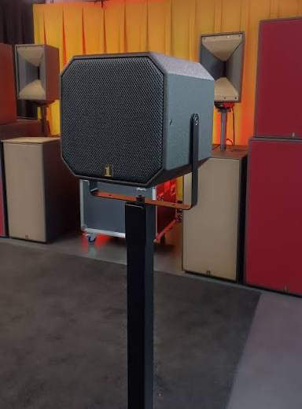

**CANNON C8**  
The C8 is a full-range, high-fidelity coaxial loudspeaker. This model utilizes an 8-inch driver with a proprietary high frequency element and has a 7-inch rear-facing passive radiator for extended low frequency. These key build features are why the C8 sounds hi-fi and has a bandwidth of 55 Hz \- 18 kHz and a maximum SPL of 120 dB.  
Available Models: C8, C8i, C8m

SPECIFICATIONS  
Description:    Passive 8” coaxial with a 7” passive radiator  
Bandwidth:    55 Hz \- 18 kHz (-6 dB)  
Max SPL:    120 dB SPL @ 1m with preset  
Power:    400 watts (program), 200 watts (AES)  
Directivity:    90° horizontal, 60° vertical  
Elements:    (1) 8” coaxial with a proprietary high frequency element, (1) 7” passive radiator  
Impedance:    8Ω 

Connectors (C8):    (2) NL4, 2-circuit switch  
Connectors (C8i):    (1) screw terminal block with input \+/- and loop \+/-  
Connectors (C8m):    (1) marine grade cable gland with 6 feet of 16/2 gauge wire in black or white

IP Rating:    IP55 indoor/outdoor and saltwater resistant  
Rigging:    (4) M6 points  
Weight:    18.4 lbs / 8.3 kg

Construction (C8 / C8i):    Finland birch plywood (phenolic resin), three coats of polyurea, matte salt and UV-resistant coating, A4 (316) stainless steel hardware, galvanized and powder-coated black or white steel input plate, 3D spacer mesh fabric  
Construction (C8m):    Finland birch plywood (phenolic resin), three coats of polyurea, matte salt and UV-resistant coating, A4 (316) stainless steel hardware, grilles, and input plate, 3D spacer mesh fabric

Accessories:    C-Clamp (wall, truss, mic stand, ceiling mounting),  L-Bracket, C8 Swivel Mount, Mounting Plate, Tube Mount, Active Speaker Stand & Tubes, Pole Mount Adaptor  
Dimensions:    10.2” (260 mm)W x 10.2” (260 mm)H x 10.2” (260 mm)D  
Colors:    Stocking black and white, custom colors and fabrics available

ADDITIONAL FEATURE (C8): The C8 has a 2-circuit switch allowing for a choice of two mixes with a 4-wire cable.  
 For the project you're describing, the C8 is potentially an excellent choice—but I would treat it as a main/mid-high cinema-performance speaker, not as the entire sound system.

The C8's combination of an 8" coaxial driver and rear 7" passive radiator is particularly interesting for a video-game cinema because it gives you full-range output from a very compact point source.

### Why the C8 makes sense

Your specifications are quite strong:

* 55 Hz–18 kHz (-6 dB) — unusually deep for a compact 8" coaxial.  
* 120 dB max SPL @ 1 m — plenty of output for a cinema-sized experience.  
* 400 W program / 200 W AES  
* 90° H × 60° V dispersion — useful for covering an audience.  
* 8 Ω  
* Coaxial design — HF and LF originate from essentially the same acoustic point.

That last part is particularly valuable for interactive video games.

With a conventional cinema setup, you might have separate LF and HF sources. With a coaxial speaker, the soundfield is more point-source-like, which can make effects such as:

helicopter moving overhead → projectile passing left → character speaking from screen-right → explosion behind audience

feel more coherent.

And the passive radiator means you're getting substantial low-frequency extension without needing a huge ported enclosure.

### But I wouldn't build the cinema entirely from C8s

I'd use something closer to this:

                        SCREEN  
        ┌───────────────────────────────────┐  
        │                                   │  
        │              IMAGE                │  
        │                                   │  
        └───────────────────────────────────┘

          C8-L       C8-C        C8-R  
            \\          │          /  
             \\         │         /  
              ───── AUDIENCE ─────

       C8-SL                         C8-SR  
          \\                           /  
           \\                         /  
            C8-RL                 C8-RR

                 ┌───────────────┐  
                 │ SUBWOOFERS    │  
                 │   20–30 Hz+   │  
                 └───────────────┘

For the main screen channels, C8s are especially attractive.

For the surround/immersive channels, I'd also consider C8s if your budget permits. Having the same/similar acoustic character around the room is extremely nice for game audio.

But I'd absolutely add dedicated subwoofers.

The C8's 55 Hz lower limit is impressive, but that's not subwoofer territory.

For your kind of experience, you want the things below \~50 Hz to be physically enormous:

* explosions  
* engines  
* earthquakes  
* monster footsteps  
* gunfire  
* music  
* cinematic impacts  
* environmental rumbles

That's where you can make the room itself feel like part of the game.

### And this is where your original “air” idea gets interesting

You could have three different layers:

1\. C8s — spatial sound

      dialogue  
       footsteps  
       bullets  
       ambience  
       music  
       positional effects

2\. Subwoofers — physical low frequency

      explosions  
       impacts  
       engines  
       bass  
       LFE

3\. Your experimental pressure/air transducers

      close projectile  
       creature attack  
       gun blast  
       shockwave  
       wind  
       environmental effects

That could be far more interesting than simply making a cinema very loud.

### The 120 dB number needs a big asterisk

Don't interpret:

120 dB @ 1 m

as “I can run these at 120 dB all evening.”

That's a maximum SPL specification, and real cinema design needs headroom, distance losses, room acoustics, amplifier limits, DSP limiting, etc.

For example, at roughly 8 m in free-field conditions, you could lose around 18 dB relative to 1 m before considering room reflections, so the theoretical relationship isn't remotely the same as having a 120 dB speaker at the audience.

But 120 dB maximum from such a small enclosure gives you valuable headroom, which is exactly what you want for transient-heavy game audio.

### One thing I particularly like about the C8

It's coaxial.

For your project, I'd seriously consider building the spatial audio engine around object-based 3D audio, rather than treating the speakers as fixed “left/right/surround” channels.

Something like:

                   GAME ENGINE

                       ↓

             OBJECT-BASED AUDIO

        Zombie \#1 → position XYZ  
        Gunshot   → position XYZ  
        Aircraft  → position XYZ  
        Voice     → position XYZ  
        Explosion → position XYZ

                       ↓

                  3D renderer

                       ↓

             ┌─────────────────┐  
             │ amplifier/DSP   │  
             └───────┬─────────┘  
                     ↓

       C8  C8  C8  C8  C8  C8  C8  
        ↓   ↓   ↓   ↓   ↓   ↓   ↓  
              AUDIENCE

Then your powerful PC isn't just playing a prerecorded 7.1 soundtrack. It is calculating where the sound exists in the room in real time.

That's particularly compelling for a live-performance/video-game hybrid.

### One caveat: C8 isn't necessarily the ideal *cinema* speaker

I'd want to hear/measure it before committing to a whole cinema.

A cinema installation has requirements beyond:

“sounds really good and gets loud.”

You need to know:

* frequency response off-axis  
* distortion at high SPL  
* compression  
* directivity consistency with frequency  
* phase behaviour  
* crossover characteristics  
* sensitivity  
* amplifier requirements  
* how well the passive radiator behaves at high excursion  
* response when multiple speakers are operating simultaneously

The 90° × 60° dispersion is promising, but the exact room geometry matters enormously.

Also, because this is a compact speaker with a rear passive radiator, placement matters. You don't want to blindly shove it against a wall and assume it will behave like the manufacturer's free-space specification.

### My verdict

For your proposed non-arcade “video-game cinema” / live gaming performance space:

| Component | My take |
| ----- | ----- |
| C8 as L/C/R | Excellent candidate |
| C8 as surrounds | Very good candidate |
| C8 as overheads | Potentially excellent |
| C8 as only speaker | ❌ |
| C8 as subwoofer | ❌ |
| Dedicated subwoofer | Absolutely |
| Separate physical-air effect | Very interesting |
| Object-based 3D audio | Strongly recommended |

And the C8's passive radiator is genuinely relevant to what you're trying to accomplish: it gives you considerably more low-frequency capability from a compact enclosure, rather than the “4-inch speaker pretending to be a subwoofer” situation you often encounter.

